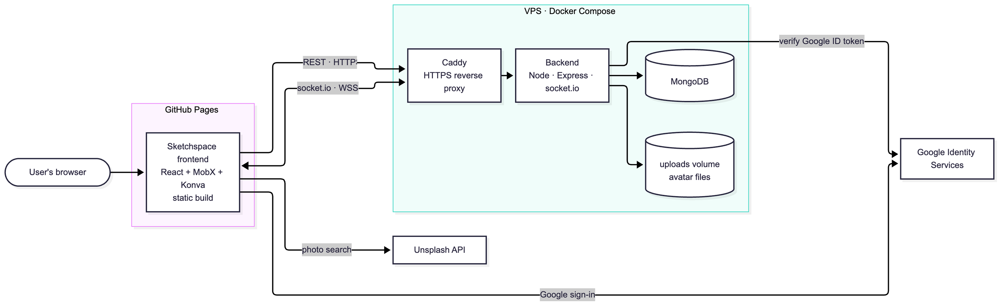

# Sketchspace Server

REST and real-time backend for [Sketchspace](https://github.com/chaimi760970774/Sketchspace), a collaborative collage and drawing app.

**Frontend repo:** [Sketchspace](https://github.com/chaimi760970774/Sketchspace) · **Live site:** [chaimi760970774.github.io/Sketchspace](https://chaimi760970774.github.io/Sketchspace/) · **API:** `https://91-98-226-226.sslip.io`

A canvas is a room that is either private (solo) or shared (collaboration). The server validates strokes and elements (shapes, photos, cutouts), stores them in MongoDB and streams them to everyone on the canvas in real time. It also handles accounts (email/password and Google), profile pictures and folders.

**Stack:** Node.js 22, TypeScript, Express 5, socket.io, MongoDB, JWT, Docker, Caddy

## System architecture



## Server architecture

| Layer | Folder | Responsibility |
|---|---|---|
| Persistence / Data Access | `src/repositories/`, `src/db.ts` | Database operations: connection, indexes, one repository per collection. |
| Model / Domain | `src/models/` | Data structures and domain entities (`Canvas`, `Stroke`, `CanvasElement`, `Folder`, `User`) with their public views. |
| Service / Business Logic | `src/services/`, `src/validation/` | Application logic and business rules, shared by REST and socket.io. |
| Controller / Routes | `src/routes/`, `src/socket/`, `src/middleware/` | HTTP requests, responses and routing; socket.io events; authentication middleware and cookies. |

```
src/
├── index.ts          Entry point: wires Express, socket.io and the database
├── cors.ts           CORS settings
├── db.ts             MongoDB connection
├── routes/           REST endpoints: auth, user, canvas, stroke, element, folder
├── socket/           socket.io events for live drawing
├── middleware/       Login check, owner token, session cookie
├── services/         Business logic: canvas, stroke, element, folder, user, auth, avatar
├── validation/       Input validation and parsing
├── models/           Domain entities and their public views
└── repositories/     MongoDB queries, one file per collection
test/                 Socket, service, HTTP and unit tests
postman/              REST collection and environment
mongodb/              MongoDB playground
public/               Demo client
```

## Getting started

Requires Node.js 22 and a running MongoDB.

```bash
npm install
cp .env.example .env     # then edit it
npm run dev              # http://localhost:3000
```

### Environment variables

| Variable | Description |
|---|---|
| `CLIENT_ORIGIN` | Frontend origin(s), comma-separated, scheme and host only (`http://localhost:8080`). Wildcards are not supported. |
| `JWT_SECRET` | Signs login tokens. Generate one with `openssl rand -hex 32`. The value in `.env.example` is for demonstration only. |
| `GOOGLE_CLIENT_ID` | Optional. Enables Google sign-in; must equal the frontend's `VITE_GOOGLE_CLIENT_ID`. Without it `POST /api/auth/google` answers `503`. |
| `MONGODB_URI` | Database connection string (set automatically by Docker Compose). |
| `PORT` | Port to listen on. Default `3000`. |
| `UPLOAD_DIR` | Where profile pictures are stored. Default `./uploads`. |
| `SITE_ADDRESS` | Docker only: public hostname for Caddy's HTTPS (`:80` for plain HTTP). |
| `HTTP_PORT`, `HTTPS_PORT`, `MONGO_PORT` | Docker only: host ports for Caddy and for inspecting MongoDB (default `27018`). |

For Google sign-in, add every address the frontend is opened from under **Authorized JavaScript origins** of the OAuth client in the [Google Cloud Console](https://console.cloud.google.com/apis/credentials), or Google answers `Error 400: origin_mismatch`.

### Scripts

| Script | Description |
|---|---|
| `npm run dev` | Start with reload |
| `npm run build` / `npm start` | Compile to `dist/` / run the compiled server |
| `npm run typecheck` | Type check source and tests |
| `npm test` | Run the test suite |

## API

Base URL `http://localhost:3000` (locally) or `https://91-98-226-226.sslip.io` (deployed). All bodies are JSON. Interactive examples are in the Postman collection in `postman/`.

### Authentication and access

- **Logged in:** send `Authorization: Bearer <token>` (returned by register, login and Google sign-in), or rely on the `httpOnly` `token` cookie. Cross-origin browser clients using the cookie must send credentials (`fetch(..., { credentials: 'include' })`, `io(url, { withCredentials: true })`).
- **Owner token:** `POST /api/canvas` returns an `ownerToken` once (only its hash is stored). Send it as the `X-Owner-Token` header, or as `{ ownerToken }` in `canvas:join`. A canvas created while logged in also belongs to the account, so its owner needs no token on any device. `POST /api/canvas/:id/claim` attaches a token-owned canvas to the account.
- **Access levels:** **Anyone**; **Shared** (anyone on a shared canvas, only the owner on a private one); **Owner**; **Logged in**.

### Errors

Errors return `{ "error": "message" }` with status `400` (invalid id or body), `401` (not logged in or bad credentials), `403` (private canvas or not the owner), `404` (not found), `409` (duplicate email or folder name), `413` (body too large), `415` (wrong media type), `503` (Google sign-in not configured) or `500`.

### REST endpoints

| Method | Endpoint | Body | Success | Access |
|---|---|---|---|---|
| GET | `/health` | | `200 { ok }` | Anyone |
| POST | `/api/auth/register` | `{ email, password, displayName }` | `201 { user, token }` | Anyone |
| POST | `/api/auth/login` | `{ email, password }` | `200 { user, token }` | Anyone |
| POST | `/api/auth/google` | `{ idToken }` | `200/201 { user, token }` | Anyone |
| GET | `/api/auth/session` | | `200 { user }` (`null` for a guest) | Anyone |
| POST | `/api/auth/logout` | | `200 { ok }` | Anyone |
| GET | `/api/users/me` | | `200` user | Logged in |
| PUT | `/api/users/me` | `{ displayName?, avatarUrl? }` | `200` user | Logged in |
| PUT | `/api/users/me/avatar` | image bytes (`image/png`, `jpeg`, `webp`, max 2 MB) | `200` user | Logged in |
| DELETE | `/api/users/me/avatar` | | `200` user | Logged in |
| DELETE | `/api/users/me` | | `200 { ok }` (also deletes its canvases and folders) | Logged in |
| POST | `/api/canvas` | `{ name?, isShared?, isPublic? }` | `201 { canvasId, ownerToken }` | Anyone |
| GET | `/api/canvas` | | `200` public canvases (the Gallery) | Anyone |
| GET | `/api/canvas/mine` | | `200` the user's canvases, each with `folderId` | Logged in |
| GET | `/api/canvas/:id` | | `200` canvas with `isOwner` | Shared |
| POST | `/api/canvas/:id/claim` | | `200 { ok }` | Logged in + owner token |
| PUT | `/api/canvas/:id` | `{ name?, isShared?, isPublic? }` | `200 { ok }` | Owner |
| PUT | `/api/canvas/:id/folder` | `{ folderId }` (`null` = no folder) | `200 { ok }` | Logged in, owns canvas and folder |
| DELETE | `/api/canvas/:id` | | `200 { ok }` | Owner |
| GET | `/api/canvas/:id/strokes` | | `200` strokes, oldest first | Shared |
| POST | `/api/canvas/:id/strokes` | stroke | `201 { strokeId }` | Shared |
| DELETE | `/api/canvas/:id/strokes/:strokeId` | | `200 { ok }` | Shared |
| DELETE | `/api/canvas/:id/strokes` | | `200 { ok, removed }` | Owner |
| GET | `/api/canvas/:id/elements` | | `200` elements, oldest first | Shared |
| POST | `/api/canvas/:id/elements` | element | `201 { elementId }` | Shared |
| PUT | `/api/canvas/:id/elements/:elementId` | changed fields | `200 { ok }` | Shared |
| DELETE | `/api/canvas/:id/elements/:elementId` | | `200 { ok }` | Shared |
| GET | `/api/folders` | | `200` the user's folders | Logged in |
| POST | `/api/folders` | `{ name }` | `201` folder | Logged in |
| PUT | `/api/folders/:id` | `{ name }` | `200` folder | Logged in, folder owner |
| DELETE | `/api/folders/:id` | | `200 { ok }` (its canvases are kept) | Logged in, folder owner |

Uploaded profile pictures are served from `/uploads/avatars/<file>`.

### Real-time (socket.io)

REST and socket.io write through the same services, so a change made either way reaches everyone on the canvas. Use the socket while a canvas is open and REST for everything else (canvas management, scripts, retries).

```js
const socket = io(API, { withCredentials: true });
socket.emit('canvas:join', canvasId, { ownerToken }, (res) => {
  if (!res.ok) return console.error(res.error);
  res.strokes.forEach(drawStroke);
  res.elements.forEach(drawElement);
});
socket.emit('stroke:add', { canvasId, layerId: 'foreground', brush: 'pen', size: 4,
  color: '#222222', opacity: 1, path: [{ x: 10, y: 12 }, { x: 14, y: 18 }] }, (res) => {});
socket.on('stroke:added', drawStroke);
```

A socket joins one canvas at a time and must join before sending anything else. Every client event has an acknowledgement receiving `{ ok: true, ...data }` or `{ ok: false, error }`. The login is read from the cookie sent with the connection; reconnect after logging in or out.

| Client to server | Payload | Ack data |
|---|---|---|
| `canvas:join` | `canvasId`, `{ ownerToken? }` | `strokes`, `elements`, `isShared`, `isPublic`, `isOwner` |
| `canvas:leave` | | |
| `stroke:add` / `stroke:delete` / `stroke:undo` | stroke / stroke id / none | `id` (add, undo) |
| `canvas:clear` (owner) | | `removed` |
| `element:add` / `element:update` / `element:delete` | element / id + changes / id | `id` (add) |

| Server to client | Payload | Meaning |
|---|---|---|
| `stroke:added`, `stroke:removed`, `stroke:deleted` | stroke or stroke id | A stroke was added, undone or deleted |
| `canvas:cleared` | | The owner cleared all strokes |
| `element:added`, `element:updated`, `element:deleted` | element or id | An element changed (`updated` carries its full new state) |
| `canvas:peers` | number | Participants in the canvas |
| `canvas:unshared`, `canvas:deleted` | | The canvas became private or was deleted; you were removed |

Changes are not echoed to the socket that made them (except `canvas:peers`); REST changes go to everyone. Concurrent element updates are last write wins. `stroke:undo` removes the caller's latest stroke; strokes added over REST cannot be undone.

### Data models

| Entity | Fields |
|---|---|
| **Canvas** | `_id`, `name` (default `untitled`), `isShared` (default `false`; anyone with the id can join), `isPublic` (default `false`; also listed in the Gallery, implies `isShared`), `layers` (`foreground`, `middleground`, `background`), `createdAt`, `updatedAt`, `folderId` (only in `/canvas/mine`) |
| **Folder** | `id`, `name` (trimmed, 1-30 characters, unique per account ignoring case), `createdAt`, `updatedAt` |
| **Stroke** | `id`, `canvasId`, `layerId`, `brush`, `color`, `size` (0-500), `opacity` (0-1), `path` (1-5000 `{ x, y }` points) |
| **Element** | `id`, `canvasId`, `type` (`shape`, `photo`, `cutout`; fixed), `x`, `y`, `width`, `height`, `rotation`, `zIndex`, plus per type: `shape`, `color` (`null` = dashed template); `url`, `photographer`, `photographerLink` (https Unsplash image); `cutWidth`, `cutHeight`, `photo` (cutout) |
| **User** | `id`, `email`, `displayName` (2-30 characters), `avatarUrl`, `hasCustomAvatar`, `createdAt` |

Elements store the image URL only; clients load the image from Unsplash. Private canvases are not listed and can be joined only by their owner. Deleting a canvas removes its strokes and elements; deleting an account removes its canvases, folders and avatar. Canvases created before owner tokens have no owner and are open to everyone.

## Testing

```bash
npm test
```

Tests need MongoDB. They use the `sketch-space-test` database and drop it afterwards; set `TEST_MONGODB_URI` to use another database whose name ends in `-test`. The default is `mongodb://localhost:27017`; if MongoDB runs only through Docker Compose it is on port `27018`:

```bash
TEST_MONGODB_URI=mongodb://localhost:27018/sketch-space-test npm test
```

To run the REST collection with the [Postman CLI](https://learning.postman.com/docs/postman-cli/postman-cli-overview/) against a running server:

```bash
postman collection run "postman/collections/sketchspace api" -e postman/environments/local.environment.yaml
```

## Deployment

The server runs on a VPS with Docker Compose: MongoDB, the backend and Caddy, which gets and renews the HTTPS certificate itself.

1. Clone the repo on the server and copy `.env.example` to `.env`. Set a real `JWT_SECRET`, `CLIENT_ORIGIN` (the deployed frontend's origin, e.g. `https://chaimi760970774.github.io`), `GOOGLE_CLIENT_ID` and `SITE_ADDRESS` (the server's public hostname).
2. `docker compose up -d --build`
3. Check `docker compose ps` and `https://<SITE_ADDRESS>/health`.

To update a running server: `ssh root@<server-ip>`, `cd ~/sketchspace-server`, `git pull`, `docker compose up -d --build`.

## Inspecting the database

MongoDB is published only on the VPS's own loopback (`127.0.0.1:27018`). To look at the hosted data from VS Code, forward that port over SSH, then connect to it with the [MongoDB for VS Code](https://marketplace.visualstudio.com/items?itemName=mongodb.mongodb-vscode) extension.

```bash
# on your computer; keep this terminal open
ssh -N -L 27018:127.0.0.1:27018 root@<server-ip>
```

In VS Code, add a connection to `mongodb://localhost:27018` and open the `sketch-space` database. Ready-made queries are in `mongodb/`.

Locally with Docker Compose, skip the SSH step and connect to `mongodb://localhost:27018` directly.
